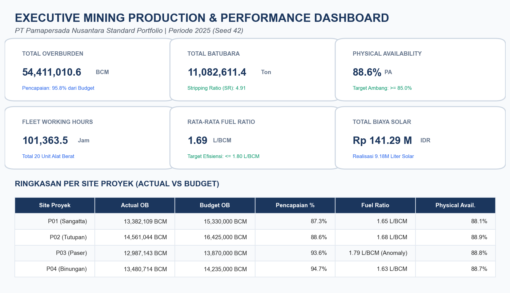
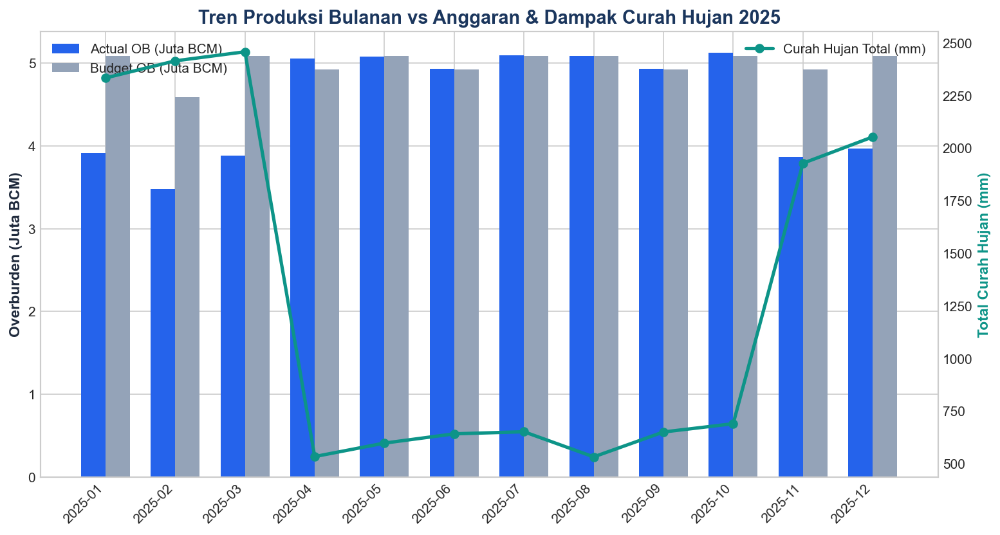
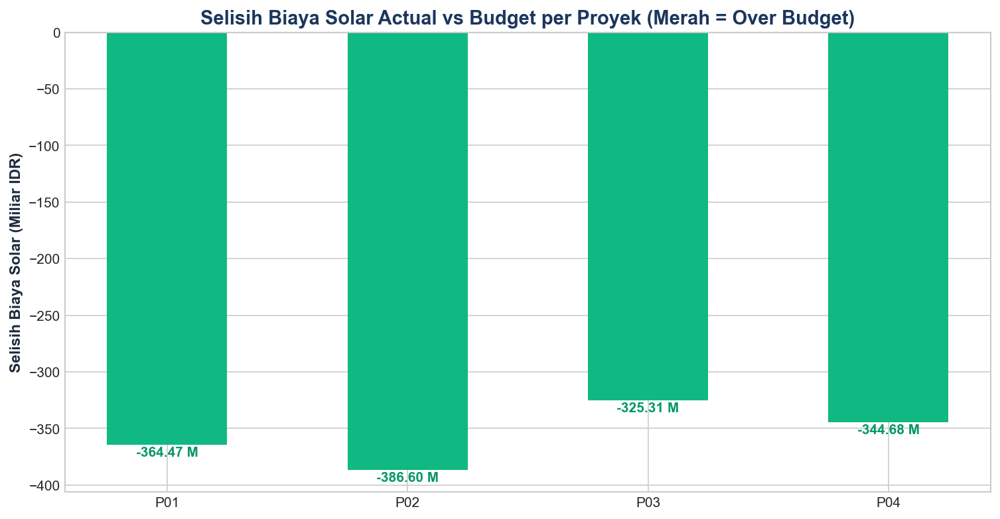

# Weekend 1: Advanced MS Excel & VBA Automation

> **DISCLAIMER:**  
> Seluruh data operasional tambang pada modul ini adalah **data sintetis** yang dibangkitkan secara matematis (`seed=42`). Tidak mencerminkan data riil perusahaan rahasia.

---

## 1. Ringkasan & Tujuan Deliverable

Modul **Weekend 1** membuktikan kompetensi *advanced data modeling* dan *programming* dengan Microsoft Excel sesuai standar industri kontraktor penambangan kelas dunia.

### Deliverable yang Dihasilkan:
1. **`Mining_Performance.xlsx` (dan `.xlsm`)**: Workbook analitik interaktif yang memodelkan 1.460 transaksi produksi, 7.300 data jam alat, 7.300 data konsumsi solar, dan anggaran biaya per proyek.
2. **`RefreshAndExport.bas`**: Modul makro VBA siap pakai yang mengotomasi pembaruan koneksi data (*Refresh All*), kalkulasi ulang formula, pencatatan log audit, dan ekspor lembar kerja *Dashboard* ke format PDF bertanggal.
3. **`output/Laporan_Produksi_Tambang_2025-12-31.pdf`**: Contoh cetak PDF resmi 1-halaman A4 Landscape.
4. **Tangkapan Layar Dashboard & Grafik Performa** di folder `output/`.

---

## 2. Struktur Worksheet

| Sheet | Tipe | Fungsi & Deskripsi |
| :--- | :---: | :--- |
| **README** | Info | Disclaimer data sintetis, dokumentasi sheet, dan panduan menjalankan makro VBA. |
| **Control** | Parameter | Seleksi interaktif kode proyek (`ALL`, `P01`, `P02`, `P03`, `P04`), rentang tanggal, ambang batas PA ($\ge 85\%$) dan target *fuel ratio* ($\le 1.80\text{ L/BCM}$). |
| **Dashboard** | Visualisasi | Ringkasan eksekutif satu halaman A4 Landscape: 6 kartu KPI utama, tabel komparasi actual vs budget, dan status target. |
| **Pivot** | Agregasi | Matriks ringkasan tahunan dan bulanan per-site proyek menggunakan kalkulasi `SUMIFS` dan `SUMPRODUCT`. |
| **Budget** | Master | Rencana anggaran bulanan: target volume BCM, kuota solar (Liter), dan biaya operasional IDR (48 baris). |
| **Data_Production** | Fakta | Transaksi harian volume Overburden (BCM), Batubara (Ton), dan curah hujan (`rainfall_mm`) (1.460 baris). |
| **Data_Equipment** | Fakta | Transaksi harian jam alat: Working, Standby, Breakdown, Available (7.300 baris). |
| **Data_Fuel** | Fakta | Transaksi konsumsi bahan bakar (Liter) dan harga solar bulanan (7.300 baris). |
| **Log** | Audit | Rekaman otomatis eksekusi makro VBA (timestamp, durasi detik, status, dan pesan error). |

---

## 3. Logika Formula & Metrik Operasional Tambang

Semua metrik operasional tambang dihitung secara dinamis tanpa nilai *hardcoded*:

1. **Physical Availability (PA)**:
   $$\text{PA} = \frac{\text{Jam Tersedia} - \text{Jam Breakdown}}{\text{Jam Tersedia}} \times 100\%$$
   *Baseline Realisasi: **88.6%** (Target: $\ge 85.0\%$)*

2. **Utilization of Availability (UA)**:
   $$\text{UA} = \frac{\text{Jam Working}}{\text{Jam Tersedia}} \times 100\%$$
   *Baseline Realisasi: **57.9%***

3. **Fuel Ratio (L/BCM)**:
   $$\text{Fuel Ratio} = \frac{\text{Total Konsumsi Solar (Liter)}}{\text{Total Produksi Overburden (BCM)}}$$
   *Baseline Realisasi: **1.69 L/BCM** (Site P03 mengalami kenaikan anomali hingga 1.79 L/BCM)*

4. **Pencapaian Target (%)**:
   $$\text{Pencapaian} = \frac{\text{Actual Production}}{\text{Target Budget}} \times 100\%$$

5. **Selisih Biaya Solar (Variance IDR)**:
   $$\text{Selisih} = \text{Actual Fuel Cost} - \text{Budget Fuel Cost}$$

---

## 4. Spesifikasi Makro Otomasi VBA (`RefreshAndExport.bas`)

Makro VBA dirancang dengan praktik terbaik *enterprise*:
- Menggunakan `On Error GoTo ErrorHandler` untuk menangkap potensi kegagalan koneksi data.
- Mematikan `Application.ScreenUpdating` dan `DisplayAlerts` selama pemrosesan untuk performa maksimal (<5 detik).
- Mengatur orientasi cetak lembar kerja Dashboard menjadi **A4 Landscape** dengan skala *fit-to-page* presisi ($1 \times 1$ halaman).
- Mengekspor PDF ke subfolder `output/` dengan penamaan dinamis: `Laporan_Produksi_Tambang_YYYY-MM-DD.pdf`.
- Mencatat riwayat audit eksekusi secara otomatis ke lembar kerja `Log`.

---

## 5. Preview Dashboard & Laporan

### Executive KPI Dashboard

### Tren Bulanan & Dampak Musim Hujan

### Analisis Varians Anggaran Bahan Bakar per Site

---
*Dibuat sebagai bagian dari rangkaian portofolio Mining Production Performance Analytics.*
